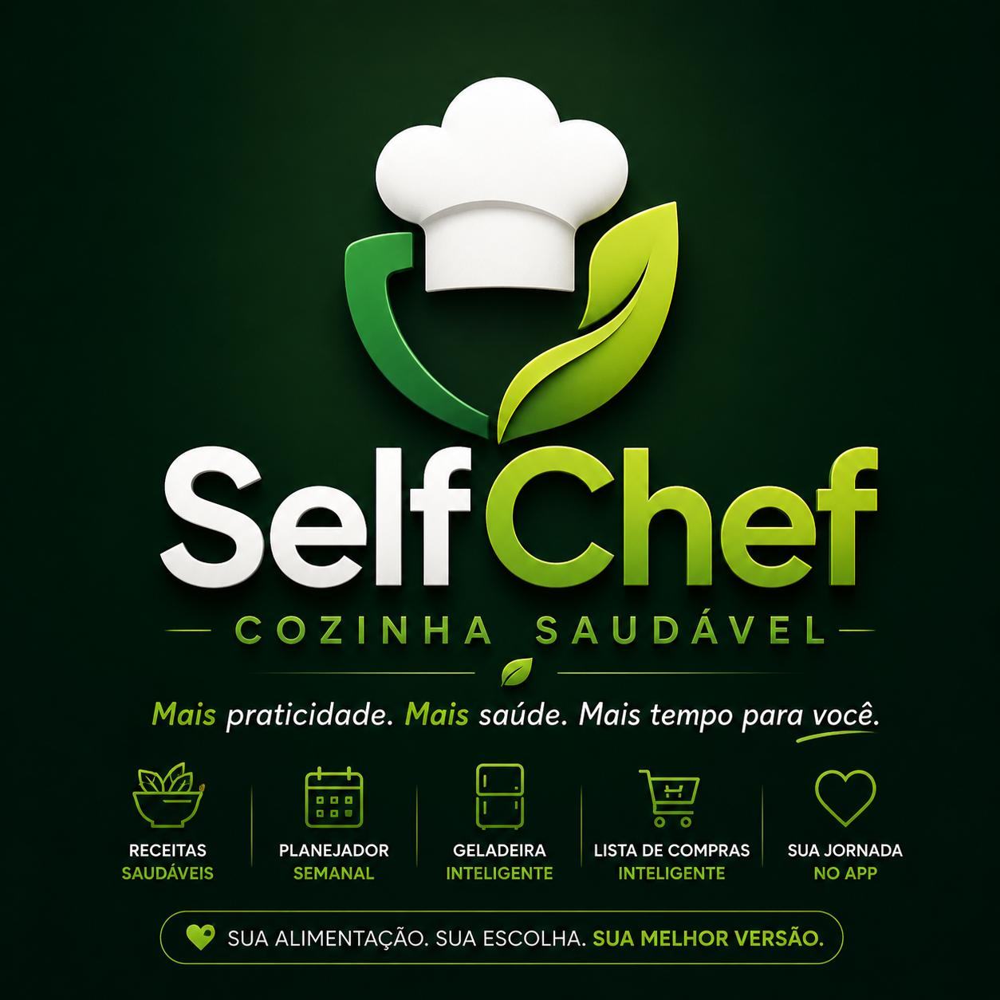

SelfChef 🥗

Mais praticidade. Mais saúde. Mais tempo para você.

Sobre o projeto

O SelfChef é uma aplicação web criada para facilitar o planejamento alimentar, a descoberta de receitas saudáveis e a organização das compras do dia a dia.

A ideia surgiu da necessidade de reunir diferentes ferramentas de organização alimentar em uma única plataforma digital, oferecendo mais praticidade aos usuários.

Principais funcionalidades

- Mais de 500 receitas: catálogo de receitas para diferentes refeições.
- Planejador Semanal: organização do cardápio ao longo da semana.
- Lista de Compras Inteligente: apoio à organização das compras e dos ingredientes.
- Geladeira Inteligente: gerenciamento de ingredientes e apoio ao planejamento das refeições.
- Interface responsiva: experiência adaptada ao uso em dispositivos móveis.

Como o projeto foi desenvolvido

O SelfChef foi desenvolvido com assistência de ferramentas de inteligência artificial, incluindo Google Gemini e ChatGPT.

Minha participação envolveu a concepção da ideia, o planejamento das funcionalidades, a definição da experiência do usuário e o acompanhamento do processo de desenvolvimento.

As ferramentas de inteligência artificial auxiliaram na geração de código, na implementação técnica e na construção da aplicação.

Tecnologias e ferramentas utilizadas

- Google Gemini: assistência na geração de código e no desenvolvimento da aplicação.
- ChatGPT: apoio ao planejamento, à estruturação das funcionalidades e ao desenvolvimento do projeto.
- Firebase: serviços de infraestrutura para a aplicação.
- Cloud Firestore (NoSQL): armazenamento e organização dos dados na nuvem.

Aprendizados

O desenvolvimento do SelfChef proporcionou experiência prática com planejamento de produtos digitais, desenvolvimento assistido por inteligência artificial, organização de dados e utilização de bancos de dados NoSQL na nuvem.

O projeto também contribuiu para ampliar meu interesse por tecnologias de dados e pelo funcionamento de aplicações digitais.

Status do projeto

Aplicação web pessoal desenvolvida com assistência de inteligência artificial.

O aplicativo possui uma interface em português.

Direitos autorais

© 2026 Caliny Silva. Todos os direitos reservados sobre os materiais originais de sua autoria, nos limites da legislação aplicável.

Este repositório possui finalidade demonstrativa e de portfólio. Sua publicação não concede licença para reprodução ou exploração comercial dos materiais protegidos aqui apresentados.
